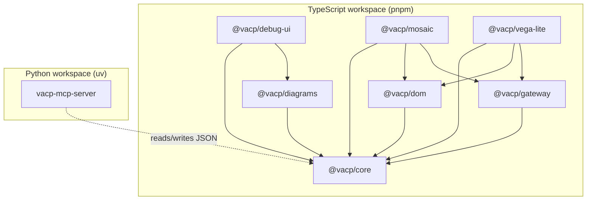
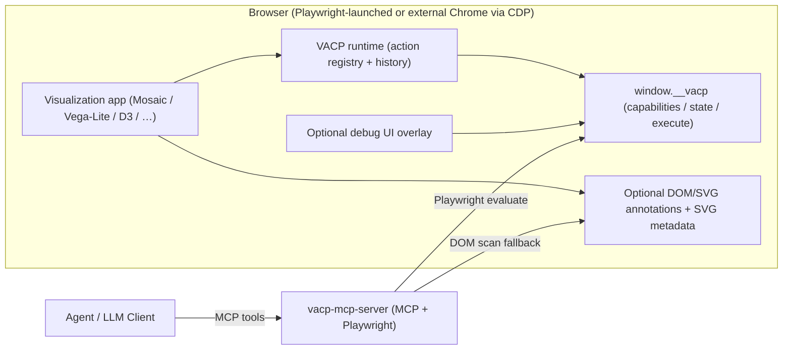

# VACP Architecture

This document explains how the `vacp/` monorepo is structured, how the runtime system works end-to-end, and why the design is “Mosaic-first but reusable”.

---

## Goals

- **Make visual analytics UIs agent-ready** without pixel-based “computer use”.
- Provide a stable, typed interface for agents:
  - **Discovery**: “what exists / what can I do?”
  - **State**: “what is selected / configured right now?”
  - **Control**: “execute this interaction safely with parameters”
- Keep the protocol **standalone** and reusable across apps, while supporting **first-class Mosaic/vgplot** integrations.

---

## Key Idea: VACP as a Graph + Actions (DOM is an adapter)

VACP’s canonical representation is:

- A **graph** of nodes and edges describing UI structure and semantics.
- A list of **action descriptors** (callable interactions) with parameter schemas.
- A **state snapshot** keyed by stable node references.

In practice you also want a small **runtime** in the app:

- records a timeline of snapshots and action results (for debugging and replay),
- enables “time travel” inspection (without mutating the live app),
- supports tooling like an in-page debug overlay.

DOM/SVG annotations are used for:

- discoverability and debugging,
- compatibility with non-cooperative apps (fallback),
- linking nodes to rendered SVG output.

But the preferred, stable integration path is a **window bridge** (`window.__vacp`) that returns canonical JSON snapshots directly.

---

## Monorepo Layout

The monorepo uses:

- **pnpm** for TypeScript packages in `vacp/packages/lib/*` and `vacp/packages/examples/*`
- **uv** for the Python MCP transport in `vacp/packages/vacp-mcp-server`

### TypeScript packages

- `vacp/packages/lib/core` (`@vacp/core`)
  - Protocol types and contracts:
    - graph model (`VacpGraph`, `VacpNode`, `VacpEdge`)
    - actions (`VacpActionDescriptor`, `VacpActionCall`, `VacpActionResult`)
    - snapshots (`VacpCapabilitiesSnapshot`, `VacpStateSnapshot`)
    - in-page bridge contract (`VacpWindowBridge`)
- `vacp/packages/lib/gateway` (`@vacp/gateway`)
  - In-page runtime + execution:
    - `VacpActionRegistry` (register/execute semantic actions)
    - `installVacpRuntimeBridge` (installs/updates a stable `window.__vacp`)
    - records history entries for actions and state changes (time travel / undo/redo tooling)
- `vacp/packages/lib/dom` (`@vacp/dom`)
  - DOM/SVG adapter:
    - `applyVacpAttributes` / `applyVacpInteractionAttributes` (`data-vacp-*`, `data-interaction-vacp-*`)
    - `embedVacpGraphInSvg` via `<metadata type="application/vacp+json">`
- `vacp/packages/lib/diagrams` (`@vacp/diagrams`)
  - Debug diagrams:
    - renders VACP graphs to Mermaid (used by the debug overlay)
- `vacp/packages/lib/mosaic` (`@vacp/mosaic`)
  - Mosaic/vgplot-first integration:
    - `installVacpOnVgplot(plot, svg, options)`:
      - annotates SVG + mark groups (`[data-index]`)
      - embeds the canonical graph in SVG metadata
      - installs `window.__vacp`
      - registers minimal actions for vgplot interactors (Interval1D/Interval2D)
- `vacp/packages/lib/vega-lite` (`@vacp/vega-lite`)
  - Vega-Lite-first integration:
    - `installVacpOnVegaLiteView({ root, view, spec, options })`
    - Exposes Vega-Lite `params` as VACP nodes:
      - variable params → `Param` nodes (ConfigLayer)
      - selection params → `Selection` nodes (InteractionFeedbackLayer)
    - Registers actions to set/clear params by name (implemented via Vega View signals)
    - Installs an in-page bridge (`window.__vacp`) for stable access
- `vacp/packages/lib/debug-ui` (`@vacp/debug-ui`)
  - Optional in-app debug overlay:
    - gated by `?vacpDebug=1` / localStorage `vacp:debug=1`
    - renders the current graph to SVG using Mermaid (on demand)
    - lets you dispatch actions and inspect the runtime timeline
    - provides a demo stepper (provider-supplied scripts)
    - can apply a state map to the live app via `vacp.apply_state`

### Python packages

- `vacp/packages/vacp-mcp-server` (`vacp-mcp-server`)
  - Runs Playwright, exposes MCP tools for:
    - `vacp_capabilities()`
    - `vacp_state()`
    - `vacp_execute(name, params, call_id)`
  - Uses a **Surface** abstraction:
    - preferred: bridge-based (calls `window.__vacp`)
    - fallback: DOM scan + SVG metadata extraction

---

## Package Dependency Overview

Why this split works:

- `@vacp/core` is dependency-free and defines the stable contract.
- Providers (`mosaic`, `vega-lite`, “D3”, …) build on `core` and `gateway` but don’t change protocol semantics.
- `@vacp/dom` is optional: the bridge is the preferred access path; DOM tags are for compatibility and debugging.

---

## Runtime Architecture (End-to-End)

### High-level system diagram

Why this is flexible:

- **Bridge-first** avoids brittle DOM scraping and stays stable across rerenders.
- **DOM fallback** keeps partially-integrated pages usable (and helps debugging).
- The **runtime** is app-local and transport-agnostic: MCP is only one way to reach it.

---

## Bidirectionality (why this matters)

The project value is _interchangeable_ control:

- A human can brush/select/click normally.
- An agent can dispatch the equivalent semantic action.
- Both produce the same state updates and show up in the same runtime history.

This is what makes “handoff” and “mixed initiative” realistic: agents are not a separate automation system; they are another client of the same contract.

---

## More detail

For the detailed interaction flows (capabilities/state/execute), design rationale, extension points, and quality gates, see `ARCHITECTURE_DETAILS.md`.
