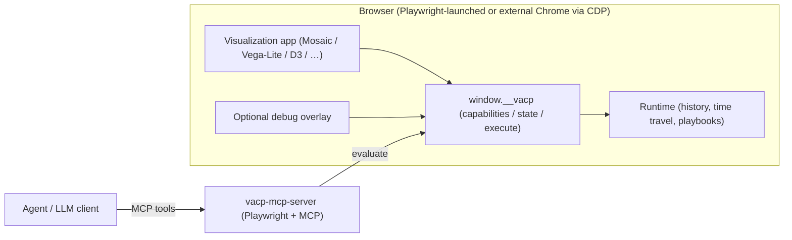
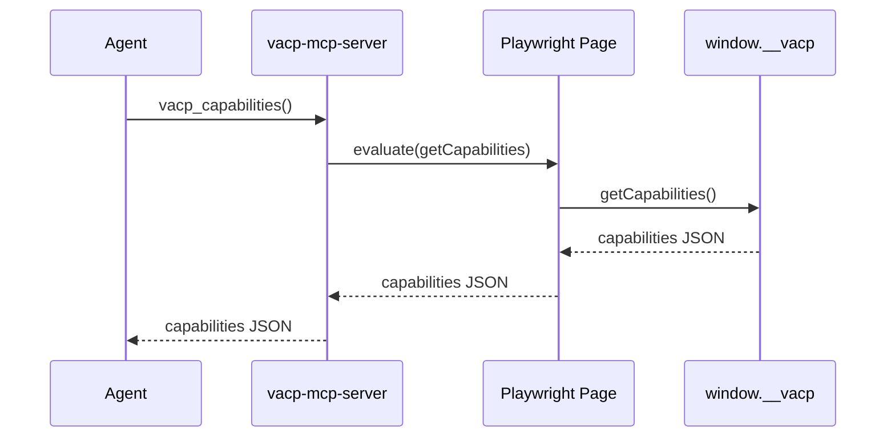
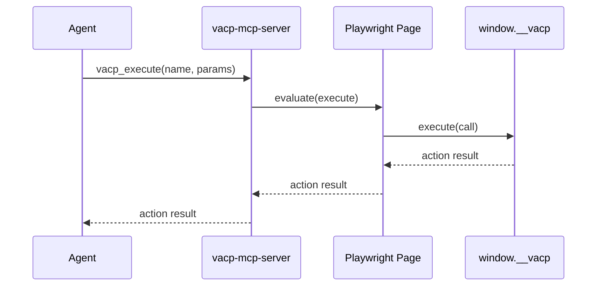

# VACP Architecture

VACP makes interactive visualization apps **agent-ready** without pixel automation.

It does this by standardizing a tiny in-page API (`window.__vacp`) that supports:

- **Capabilities**: “what exists and what can I do?”
- **State**: “what is currently selected / configured?”
- **Actions**: “perform a semantic interaction with parameters”

This document describes the system design and the VACP protocol implemented in this repository.

---

## System overview



Key idea: **the protocol lives inside the app**. MCP is only one transport.

---

## Bidirectional control

The goal is “mixed initiative”: human and agent can interleave work seamlessly.

- A **human** brushes/clicks/toggles in the UI.
- The app updates its semantic state (selection, param, etc.).
- The VACP bridge reports that state via `getState()`.
- An **agent** can apply the same semantic change by calling a named action (no pixels).
- Both paths are recorded into one shared runtime history for debugging/time travel.

---

## Protocol

This repo implements VACP as a small set of JSON messages plus an in-page RPC interface.

### Terms

- **Ref**: a stable identifier for a semantic entity (string; often `vacp://…`).
- **Graph**: a semantic model of the UI (nodes + edges + actions).
- **Capabilities snapshot**: a timestamped graph.
- **State snapshot**: timestamped values keyed by `ref`.
- **Action**: a named semantic operation with a JSON parameter schema.

### Conformance

An implementation is “VACP-conformant” if it:

- **MUST** provide `getCapabilities()`, `getState()`, and `execute(call)` via a stable bridge object (typically `window.__vacp`).
- **MUST** use stable `ref` strings as identifiers (not DOM position).
- **MUST** return versioned snapshots with ISO timestamps.
- **SHOULD** ensure actions are safe and validated (reject invalid params; do not rely on pixel events).
- **MAY** additionally expose runtime/history APIs (`getRuntime`, `undo/redo`, playbooks, overrides) for debugging and research workflows.
- **MAY** additionally expose runtime/history APIs (`getRuntime`, `undo/redo`, playbooks, overrides) for debugging and research workflows.

### Data model

The canonical semantic model is a directed labeled graph:

- `G = (V, E)` where `V` are nodes and `E` are edges.
- Each node has a unique `ref` and a `kind` (e.g. `View`, `Visualization`, `Param`, `Selection`, `InteractionTarget`).
- Edges describe relationships (e.g. `contains`, `controls`, `depends_on`).

Actions are attached to the graph as descriptors:

```ts
type VacpActionDescriptor = {
  name: string; // stable action id, e.g. "mosaic.set_interval_1d"
  description?: string; // human-readable
  parameters: object; // JSON-schema-like shape
  targetRef?: string; // optional: node this action applies to
};
```

### Snapshots

Capabilities snapshot (what exists):

```ts
type VacpCapabilitiesSnapshot = {
  version: string;
  createdAt: string; // ISO timestamp
  graph: { version: string; nodes: VacpNode[]; edges: VacpEdge[]; actions: VacpActionDescriptor[] };
};
```

State snapshot (what is currently true):

```ts
type VacpStateSnapshot = {
  version: string;
  createdAt: string; // ISO timestamp
  state: Record<string /* ref */, unknown /* typed by kind */>;
};
```

Design note: **state is keyed by `ref`**, not by DOM position. This is what makes the protocol stable across rerenders.

### Action calls and results

```ts
type VacpActionCall = { callId: string; name: string; params?: unknown };
type VacpActionResult = { callId: string; ok: boolean; result?: unknown; error?: { message: string } };
```

### In-page bridge

Providers install a bridge (usually) at `window.__vacp`:

```ts
interface VacpWindowBridge {
  getCapabilities(): Promise<VacpCapabilitiesSnapshot>;
  getState(): Promise<VacpStateSnapshot>;
  execute(call: VacpActionCall): Promise<VacpActionResult>;
}
```

This repo’s runtime bridge may also provide optional debugging endpoints:

- `getRuntime()` (history, cursor, “inspect” vs “live”)
- `dispatch(call, options)` (records source/message)
- `getPlaybooks()` (scripted stepper)
- `undo/redo`, `setMode`, `setStateOverride`, `setGraphOverride`, `refresh`, `subscribe`

### Invariants and design intent

These invariants are what make the protocol useful for mixed-initiative systems:

- **Stability**: the same `ref` keeps meaning across rerenders and time.
- **Semantic actions**: actions describe intent (e.g. “set interval selection”), not “click this DOM node”.
- **Bidirectionality**: human input and agent calls produce compatible state snapshots.
- **Transport-agnostic**: MCP, WebSocket, or any other wire can carry the same messages.

### MCP mapping

The Python `vacp-mcp-server` maps the bridge to MCP tools:

- `vacp_capabilities()` → `window.__vacp.getCapabilities()`
- `vacp_state()` → `window.__vacp.getState()`
- `vacp_execute(name, params?, call_id?)` → `window.__vacp.execute({callId, name, params})`

## Control and observation flows





---

## Implementation map

TypeScript (pnpm):

- `@vacp/core`: protocol types (the JSON contract).
- `@vacp/gateway`: runtime bridge + action registry + history/time travel.
- `@vacp/kit`: small helpers for “bring-your-own-provider” integrations (used by vanilla/D3 examples).
- `@vacp/diagrams`: Mermaid source generation for graphs.
- `@vacp/debug-ui`: in-page overlay that inspects `window.__vacp`.
- `@vacp/vgplot`: provider for Mosaic/vgplot.
- `@vacp/vega-lite`: provider for Vega-Lite/Vega views.

Python (uv):

- `vacp-mcp-server`: MCP transport that uses Playwright to call the in-page bridge (`window.__vacp`).

---

## Quality gates

From `vacp/`:

- Format: `pnpm format`
- Lint: `pnpm lint`
- Typecheck: `pnpm typecheck`
- Web smoke tests (runs all examples): `pnpm test:examples`
- MCP server tests: `pnpm test:server`
