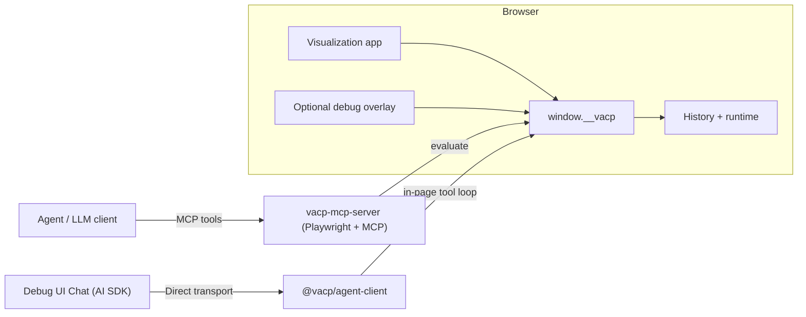

# VACP Architecture

VACP makes interactive visualization apps agent-ready by standardizing a compact in-page semantic bridge (`window.__vacp`). The bridge exposes capabilities, state, and actions so agents and humans operate on the same model.

## System Overview



Core design rule: the protocol lives inside the app. Transport layers are adapters.

## Bidirectional Control Model

VACP is mixed-initiative by design:

- Human interactions update app state.
- The bridge returns the resulting semantic state.
- Agents apply the same changes via semantic action calls.
- Both paths are recorded in one runtime history.

## Protocol Surface

### Terms

- **Ref**: stable semantic identifier (often `vacp://...`).
- **Graph**: semantic model (nodes, edges, actions).
- **Capabilities snapshot**: timestamped graph snapshot.
- **State snapshot**: timestamped values keyed by `ref`.
- **Action**: named semantic operation with parameter schema.

### Conformance

A VACP-conformant implementation:

- **MUST** expose `getCapabilities(request?)`, `getState(request?)`, and `execute(call)` through a stable bridge object (typically `window.__vacp`).
- **MUST** use stable `ref` identifiers rather than DOM position.
- **MUST** return versioned snapshots with ISO timestamps.
- **SHOULD** validate semantic action parameters and reject invalid calls.
- **MAY** expose runtime/history APIs (`getRuntime`, `undo/redo`, overrides) for debugging and research workflows.

### Bridge shape

```ts
interface VacpWindowBridge {
  getCapabilities(request?): Promise<VacpCapabilitiesSnapshot>;
  getState(request?): Promise<VacpStateSnapshot | VacpStateUpdate>;
  execute(call: VacpActionCall): Promise<VacpActionResult>;
}
```

## Semantic Data Model

- Graph: directed labeled graph `G = (V, E)`.
- Nodes: unique `ref` + semantic `kind`.
- Edges: semantic relationships (`contains`, `controls`, `depends_on`, ...).
- Actions: stable descriptors with JSON-schema-like parameter definitions.

State is keyed by semantic `ref`, not by render position. This provides stability across rerenders and layout changes.

## Transport Abstraction

Transport adapters should expose the same semantic envelope:

- `vacp_capabilities(options?)`
- `vacp_state(options?)`
- `vacp_execute(name, params?, call_id?)`

Current implementations in this repo:

- Python MCP adapter: `packages/lib/transports/mcp-server`
- In-page AI SDK adapter: `packages/lib/transports/agent-client`

## Scoped Capabilities

`getCapabilities(request?)` supports optional scoping for token efficiency:

- reference scoping (`refs`, `prefixes`)
- semantic filters (`kinds`, `layers`)
- selective payload toggles (`includeEdges`, `includeActions`, `includeNodeData`)

No request means full capabilities snapshot.

## State Tokens and Delta Updates

`getState(request?)` supports full and delta-style responses:

- **Full mode** returns a scoped snapshot and token.
- **Delta mode** returns token transition metadata and changed/removed refs.
- **Auto mode** falls back to full when baseline tokens are unavailable.

State tokens are deterministic hashes over canonicalized scoped payloads, enabling efficient polling and auditable transitions.

Implementation reference:

- `packages/lib/protocol/gateway/src/runtime/create-runtime-bridge.ts`
- `packages/lib/protocol/gateway/src/runtime/state-update.ts`

## Optional DOM Snapshot Channel

For DOM-only automation workflows, the gateway can inject semantic snapshot JSON scripts rooted at `#__vacp_snapshot`.

Design intent:

- expose manifest + graph + state index/catalog + per-ref payloads
- rewrite only changed parts on update cycles
- allow incremental reads by consumers

This channel is optional and can be disabled with `VACP_DOM_SNAPSHOT=0` or `?vacp-dom-snapshot=0`.

## Debug Overlay

The overlay (`@vacp/debug-ui`) is enabled by default when an app installs it. Disable it with `VACP_DEBUG_UI=0` or `?vacp-debug=0`.

## Implementation Map

TypeScript workspace (`packages/lib/*`):

- `@vacp/core`: protocol types
- `@vacp/gateway`: runtime bridge + history
- `@vacp/kit`: provider integration helpers
- `@vacp/duckdb`: SQL helpers for data actions
- `@vacp/diagrams`: Mermaid graph rendering source
- `@vacp/debug-ui`: in-page inspection overlay
- `@vacp/agent-client`: in-page transport/tool loop
- `@vacp/vgplot`: VGPlot provider
- `@vacp/vega-lite`: Vega-Lite provider

Python transport (`packages/lib/transports/mcp-server`):

- MCP server that calls the in-page bridge through Playwright.

## Related docs

- `docs/core-runtime/index.md`
- `docs/providers/index.md`
- `docs/transports/index.md`
- `docs/reference/tool-contract.md`
- `docs/reference/configuration.md`
- `CONTRIBUTING.md`
