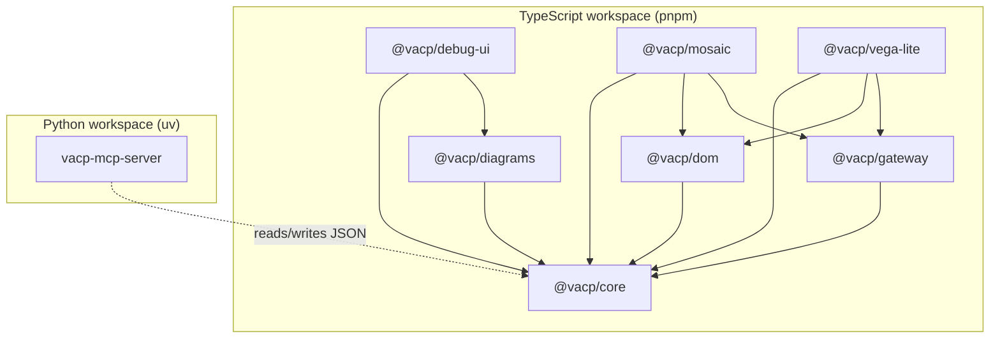
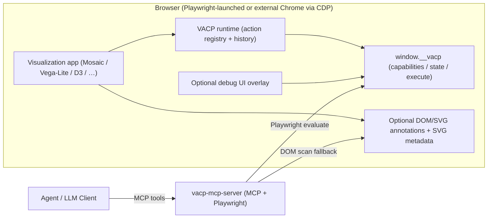
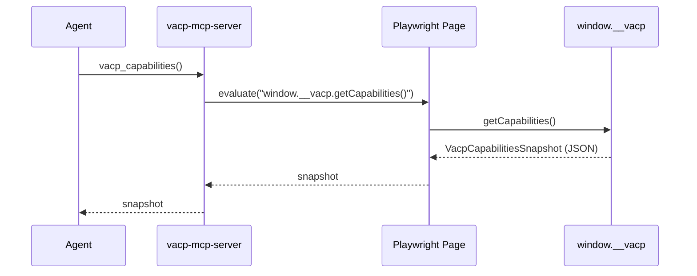
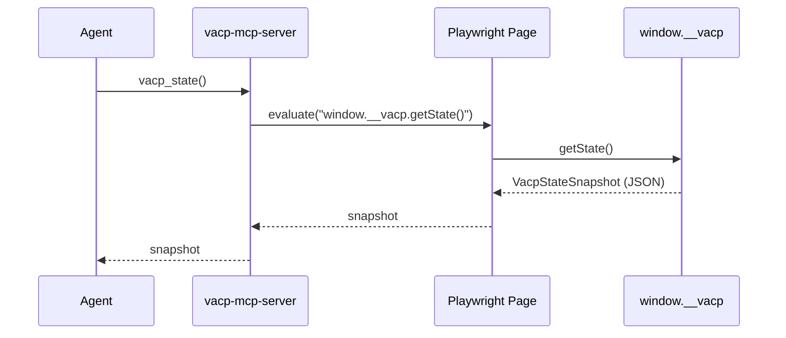
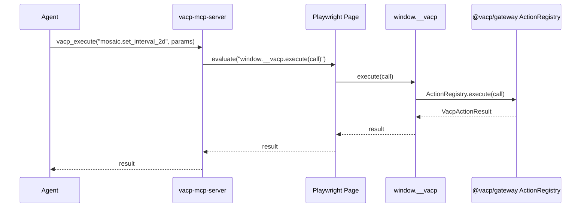

# VACP Architecture

This document explains how the `vacp/` monorepo is structured, how the runtime system works end-to-end, and why the design is “Mosaic-first but reusable”.

---

## Goals

- **Make visual analytics UIs agent-ready** without pixel-based “computer use”.
- Provide a stable, typed interface for agents:
  - **Discovery**: “what exists / what can I do?”
  - **State**: “what is selected / configured right now?”
  - **Control**: “execute this interaction safely with parameters”
- Keep the protocol **standalone** and reusable across apps, while supporting **first-class Mosaic/vgplot** integrations.

---

## Key Idea: VACP as a Graph + Actions (DOM is an adapter)

VACP’s canonical representation is:

- A **graph** of nodes and edges describing UI structure and semantics.
- A list of **action descriptors** (callable interactions) with parameter schemas.
- A **state snapshot** keyed by stable node references.

In practice you also want a small **runtime** in the app:

- records a timeline of snapshots and action results (for debugging and replay),
- enables “time travel” inspection (without mutating the live app),
- supports tooling like an in-page debug overlay.

DOM/SVG annotations are used for:

- discoverability and debugging,
- compatibility with non-cooperative apps (fallback),
- linking nodes to rendered SVG output.

But the preferred, stable integration path is a **window bridge** (`window.__vacp`) that returns canonical JSON snapshots directly.

---

## Monorepo Layout

The monorepo uses:

- **pnpm** for TypeScript packages in `vacp/packages/*`
- **uv** for Python packages in `vacp/packages/server/*`

### TypeScript packages

- `vacp/packages/core` (`@vacp/core`)
  - Protocol types and contracts:
    - graph model (`VacpGraph`, `VacpNode`, `VacpEdge`)
    - actions (`VacpActionDescriptor`, `VacpActionCall`, `VacpActionResult`)
    - snapshots (`VacpCapabilitiesSnapshot`, `VacpStateSnapshot`)
    - in-page bridge contract (`VacpWindowBridge`)
- `vacp/packages/gateway` (`@vacp/gateway`)
  - In-page runtime + execution:
    - `VacpActionRegistry` (register/execute semantic actions)
    - `installVacpRuntimeBridge` (installs/updates a stable `window.__vacp`)
    - records history entries for actions and state changes (time travel / undo/redo tooling)
- `vacp/packages/dom` (`@vacp/dom`)
  - DOM/SVG adapter:
    - `applyVacpAttributes` / `applyVacpInteractionAttributes` (`data-vacp-*`, `data-interaction-vacp-*`)
    - `embedVacpGraphInSvg` via `<metadata type="application/vacp+json">`
- `vacp/packages/mosaic` (`@vacp/mosaic`)
  - Mosaic/vgplot-first integration:
    - `installVacpOnVgplot(plot, svg, options)`:
      - annotates SVG + mark groups (`[data-index]`)
      - embeds the canonical graph in SVG metadata
      - installs `window.__vacp`
      - registers minimal actions for vgplot interactors (Interval1D/Interval2D)
- `vacp/packages/vega-lite` (`@vacp/vega-lite`)
  - Vega-Lite-first integration:
    - `installVacpOnVegaLiteView({ root, view, spec, options })`
    - Exposes Vega-Lite `params` as VACP nodes:
      - variable params → `Param` nodes (ConfigLayer)
      - selection params → `Selection` nodes (InteractionFeedbackLayer)
    - Registers actions to set/clear params by name (implemented via Vega View signals)
    - Installs an in-page bridge (`window.__vacp`) for stable access
- `vacp/packages/debug-ui` (`@vacp/debug-ui`)
  - Optional in-app debug overlay:
    - gated by `?vacpDebug=1` / localStorage `vacp:debug=1`
    - renders the current graph to SVG using Mermaid (on demand)
    - lets you dispatch actions and inspect the runtime timeline

### Python packages

- `vacp/packages/server/vacp-mcp-server` (`vacp-mcp-server`)
  - Runs Playwright, exposes MCP tools for:
    - `vacp_capabilities()`
    - `vacp_state()`
    - `vacp_execute(name, params, call_id)`
  - Uses a **Surface** abstraction:
    - preferred: bridge-based (calls `window.__vacp`)
    - fallback: DOM scan + SVG metadata extraction

---

## Package Dependency Overview

Why this split works:

- `@vacp/core` is dependency-free and defines the stable contract.
- Providers (`mosaic`, `vega-lite`, “D3”, …) build on `core` and `gateway` but don’t change protocol semantics.
- `@vacp/dom` is optional: the bridge is the preferred access path; DOM tags are for compatibility and debugging.

---

## Runtime Architecture (End-to-End)

### High-level system diagram

Why this is flexible:

- **Bridge-first** avoids brittle DOM scraping and stays stable across rerenders.
- **DOM fallback** keeps partially-integrated pages usable (and helps debugging).
- The **runtime** is app-local and transport-agnostic: MCP is only one way to reach it.

---

## Bidirectionality (why this matters)

The project value is _interchangeable_ control:

- A human can brush/select/click normally.
- An agent can dispatch the equivalent semantic action.
- Both produce the same state updates and show up in the same runtime history.

This is what makes “handoff” and “mixed initiative” realistic: agents are not a separate automation system; they are another client of the same contract.

---

## Control & Observation Flows

### 1) Discovery: capabilities snapshot

Fallback path (if `window.__vacp` is missing):

- `vacp-mcp-server` scans `data-vacp-*` and/or parses SVG `<metadata type="application/vacp+json">`.

### 2) State: current selections / params

### 3) Control: execute an interaction

Why this is better than pixel automation:

- The agent does not click or drag pixels.
- The action handler can enforce parameter validation and app-specific safety.

---

## Mosaic/vgplot Integration: Why it’s “First-Class”

Observable Plot is a renderer. Mosaic/vgplot is a **semantic runtime**:

- It knows:
  - data sources / table refs,
  - how encodings map to fields,
  - which interactors exist and how they modify selections,
  - how linked views synchronize.
- Therefore vgplot is the correct level to generate:
  - stable refs,
  - meaningful action descriptors,
  - state snapshots aligned with the app’s semantics (not DOM quirks).

In this repo, `@vacp/mosaic` provides a minimal implementation that:

- annotates the produced SVG (and `[data-index]` mark groups),
- embeds a canonical VACP graph into SVG metadata,
- installs an in-page bridge (`window.__vacp`) for fast/robust MCP access,
- exposes basic interactor actions for Interval1D/Interval2D.

---

## Surfaces (Python MCP): Why a Surface abstraction?

`vacp-mcp-server` models the target app as a `Surface` with three operations:

- `get_capabilities()`
- `get_state()`
- `execute(call)`

This cleanly supports:

- **bridge-first**: `PlaywrightBridgeSurface`
- **fallback**: `PlaywrightDomSurface`
- future backends: Selenium, remote CDP, native apps, etc.

This keeps the MCP server generic and avoids hardcoding Mosaic logic into Python.

In practice, this also enables two browser modes:

- **Playwright-launched** (default): easiest for automation and CI.
- **External Chrome via CDP**: best for interactive development (keep tabs/cookies/localStorage).

---

## Design Justifications (tradeoffs and rationale)

### Bridge-first is the default

Pros:

- stable IDs and schemas across rerenders
- fast (no full DOM traversal)
- can expose non-DOM state (selections, params, computed summaries)

Cons:

- requires cooperative app integration (installing the bridge)

### DOM/SVG annotations remain important

Pros:

- supports partially-integrated apps
- makes debugging easier (inspect DOM to see VACP tags)
- enables “view source”-like offline artifact capture (SVG metadata)

Cons:

- scanning is slower and less stable than a canonical bridge
- DOM order is not a reliable identity strategy for dynamic apps

### Mosaic-first integration does not reduce reusability

The reusable parts are `@vacp/core` + `@vacp/gateway`:

- any app can create snapshots and register actions
- Mosaic is only one provider that uses those abstractions

---

## How to extend

### Add new actions

- Define a `VacpActionDescriptor` (name, description, parameter schema, targetRef).
- Register handler via `VacpActionRegistry.register(descriptor, handler)`.
- Include the descriptor in the capabilities graph.

### Add new node kinds / summaries

- Add a new node in the graph with a stable `ref`.
- Put its current state under `VacpStateSnapshot.state[ref]`.
- Optionally include fast summaries (`summary[ref]`) to avoid “DataLayer explosion”.

### Add a new integration provider

Create a package like `@vacp/<provider>` that:

- builds snapshots from your app’s runtime model,
- registers actions,
- optionally annotates DOM/SVG for discoverability,
- installs `window.__vacp`.

---

## Tooling / Quality Gates

- TypeScript:
  - `oxlint` for lint (`pnpm -C vacp -r lint`)
  - `prettier` for formatting (`pnpm -C vacp format`)
  - `tsc -b` project references for typechecking/build (`pnpm -C vacp -r typecheck`)
- Python:
  - `ruff` for lint + format (`uv run ruff check ...`, `uv run ruff format ...`)
  - `ty` for typechecking (run it in the project env so imports resolve): `cd packages/server/vacp-mcp-server && uv run --with ty ty check src/vacp_mcp_server`
