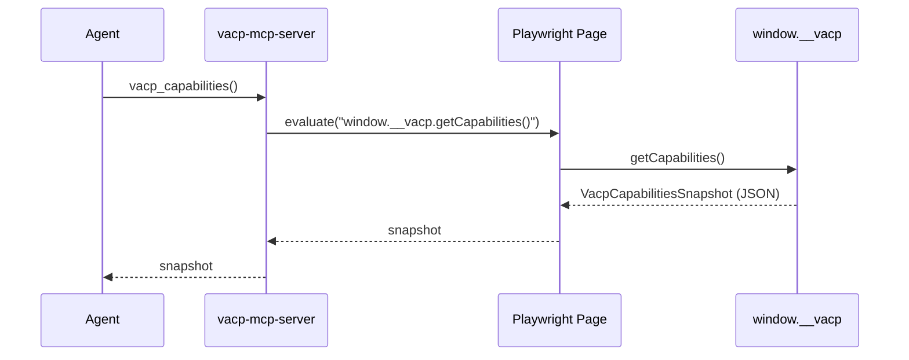
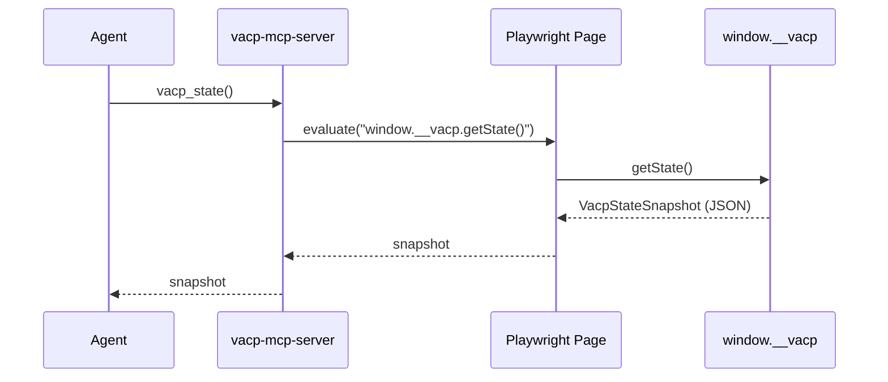
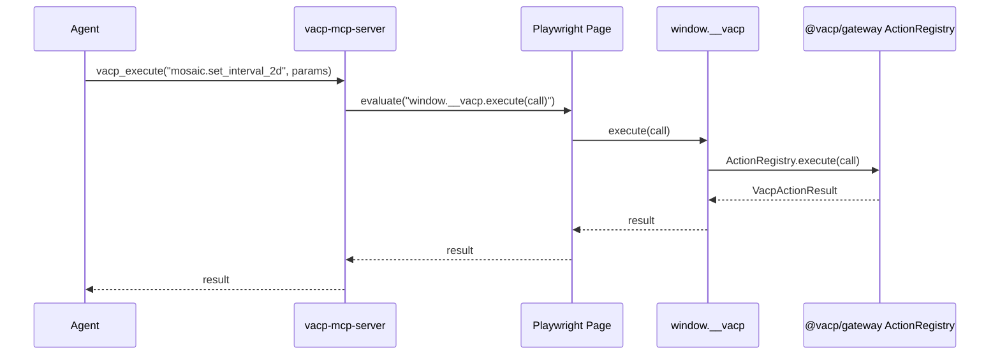

# VACP Architecture Details

This document is a companion to `ARCHITECTURE.md`. It focuses on the concrete request/response flows and the rationale behind key design choices.

---

## Control & Observation Flows

### 1) Discovery: capabilities snapshot

Fallback path (if `window.__vacp` is missing):

- `vacp-mcp-server` scans `data-vacp-*` and/or parses SVG `<metadata type="application/vacp+json">`.

### 2) State: current selections / params

### 3) Control: execute an interaction

Why this is better than pixel automation:

- The agent does not click or drag pixels.
- The action handler can enforce parameter validation and app-specific safety.

---

## Mosaic/vgplot Integration: Why it’s “First-Class”

Observable Plot is a renderer. Mosaic/vgplot is a **semantic runtime**:

- It knows:
  - data sources / table refs,
  - how encodings map to fields,
  - which interactors exist and how they modify selections,
  - how linked views synchronize.
- Therefore vgplot is the correct level to generate:
  - stable refs,
  - meaningful action descriptors,
  - state snapshots aligned with the app’s semantics (not DOM quirks).

In this repo, `@vacp/mosaic` provides a minimal implementation that:

- annotates the produced SVG (and `[data-index]` mark groups),
- embeds a canonical VACP graph into SVG metadata,
- installs an in-page bridge (`window.__vacp`) for fast/robust MCP access,
- exposes basic interactor actions for Interval1D/Interval2D.

---

## Surfaces (Python MCP): Why a Surface abstraction?

`vacp-mcp-server` models the target app as a `Surface` with three operations:

- `get_capabilities()`
- `get_state()`
- `execute(call)`

This cleanly supports:

- **bridge-first**: `PlaywrightBridgeSurface`
- **fallback**: `PlaywrightDomSurface`
- future backends: Selenium, remote CDP, native apps, etc.

This keeps the MCP server generic and avoids hardcoding Mosaic logic into Python.

In practice, this also enables two browser modes:

- **Playwright-launched** (default): easiest for automation and CI.
- **External Chrome via CDP**: best for interactive development (keep tabs/cookies/localStorage).

---

## Design Justifications (tradeoffs and rationale)

### Bridge-first is the default

Pros:

- stable IDs and schemas across rerenders
- fast (no full DOM traversal)
- can expose non-DOM state (selections, params, computed summaries)

Cons:

- requires cooperative app integration (installing the bridge)

### DOM/SVG annotations remain important

Pros:

- supports partially-integrated apps
- makes debugging easier (inspect DOM to see VACP tags)
- enables “view source”-like offline artifact capture (SVG metadata)

Cons:

- scanning is slower and less stable than a canonical bridge
- DOM order is not a reliable identity strategy for dynamic apps

### Mosaic-first integration does not reduce reusability

The reusable parts are `@vacp/core` + `@vacp/gateway`:

- any app can create snapshots and register actions
- Mosaic is only one provider that uses those abstractions

---

## How to extend

### Add new actions

- Define a `VacpActionDescriptor` (name, description, parameter schema, targetRef).
- Register handler via `VacpActionRegistry.register(descriptor, handler)`.
- Include the descriptor in the capabilities graph.

### Add new node kinds / summaries

- Add a new node in the graph with a stable `ref`.
- Put its current state under `VacpStateSnapshot.state[ref]`.
- Optionally include fast summaries (`summary[ref]`) to avoid “DataLayer explosion”.

### Add a new integration provider

Create a package like `@vacp/<provider>` that:

- builds snapshots from your app’s runtime model,
- registers actions,
- optionally annotates DOM/SVG for discoverability,
- installs `window.__vacp`.

---

## Tooling / Quality Gates

- TypeScript:
  - `oxlint` for lint (`pnpm -C vacp -r lint`)
  - `prettier` for formatting (`pnpm -C vacp format`)
  - `tsc -b` project references for typechecking/build (`pnpm -C vacp -r typecheck`)
- Python:
  - `ruff` for lint + format (`uv run ruff check ...`, `uv run ruff format ...`)
  - `ty` for typechecking (run it in the project env so imports resolve): `cd packages/vacp-mcp-server && uv run --with ty ty check src/vacp_mcp_server`
