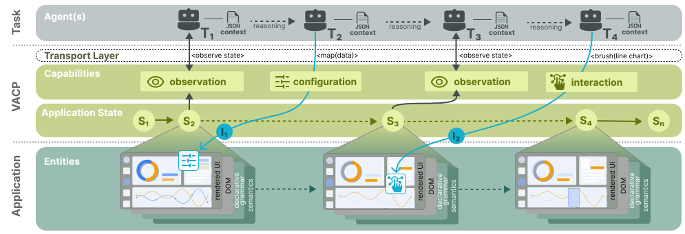

# VACP: Visual Analytics Context Protocol

[](https://arxiv.org/abs/2603.29322)
[](https://vacp.dev)



VACP lets AI agents read and change visual analyses through named actions, while the person using them watches each step. Providers describe [Vega-Lite](https://vega.github.io/vega-lite/) charts, [Mosaic vgplot](https://idl.uw.edu/mosaic/vgplot/) dashboards, and custom applications as one graph of views, selections, parameters, and data handles. External agents connect through the [Model Context Protocol](https://modelcontextprotocol.io) (MCP), agents in the page use [AI SDK](https://ai-sdk.dev) tools, and browser agents use [WebMCP](https://webmachinelearning.github.io/webmcp/). Presence shows the agent's cursor and one sentence per step, and replay restores the charts to each checkpoint.

Try the [examples gallery](https://examples.vacp.dev/), then read the [documentation](https://docs.vacp.dev/). Coding agents can read it as Markdown from [`llms.txt`](https://docs.vacp.dev/llms.txt).

## Add VACP to an application

```bash
pnpm add @ethivia/vacp-sdk zod
```

[Custom provider](docs/custom-provider/index.md) builds a custom provider. [Install](docs/install/index.md) lists the packages for Vega-Lite, Mosaic vgplot, DuckDB, in-page agents, and presence, and the libraries each one expects the application to provide.

## Install the agent skill

The VACP agent skill teaches a coding agent to add VACP to your application. The [`skills` CLI](https://github.com/vercel-labs/skills) installs it for Claude Code, Cursor, Codex, and other agents:

```bash
npx skills add https://github.com/ETH-IVIA-Lab/VACP --skill vacp
```

## Run it locally

Install [pnpm](https://pnpm.io/installation) 11 or newer and [uv](https://docs.astral.sh/uv/getting-started/installation/). pnpm switches to the pinned release and downloads the declared Node.js.

```bash
pnpm install
pnpm dev
```

`pnpm dev` serves the gallery at `https://examples.vacp.localhost` through [Portless](https://github.com/vercel-labs/portless), a local proxy that gives each app an HTTPS name. Its first run asks you to trust a local certificate authority. `pnpm dev:docs` serves the documentation at `https://docs.vacp.localhost`. To let an MCP client such as Claude Code drive a page, follow [Get started](docs/get-started/index.md#let-an-agent-move-the-slider).

## Repository

| Path                 | Contents                                                                                                           |
| -------------------- | ------------------------------------------------------------------------------------------------------------------ |
| `packages/`          | The npm packages `sdk`, `vega`, `vgplot`, `duckdb`, `ai`, `react`, and `posthog`, and the `python` package         |
| `skills/vacp`        | The VACP agent skill                                                                                               |
| `examples/`          | The gallery and its five applications                                                                              |
| `apps/e2e`           | Playwright tests through the browser and the public bridge                                                         |
| `apps/evals`         | Agent evaluations on the examples                                                                                  |
| `apps/docs`          | The VitePress app that builds the documentation site                                                               |
| `docs/`              | The Markdown pages of the documentation site                                                                       |
| `development_docs/`  | [Development guides](development_docs/index.md) for architecture, contributing, testing, examples, and performance |
| `scripts/`, `tools/` | Workspace packages for repository scripts, and for lint rules and StyleX tooling                                   |

Run `pnpm ready` for every static gate, unit suite, and package check. Run `pnpm e2e:install` once, then `pnpm e2e` for the browser suite.

## Citation

```bibtex
@article{staehle2026vacp,
  title = {{VACP}: {Visual Analytics Context Protocol}},
  author = {{St{\"a}hle}, Tobias and {Gyarmati}, P{\'e}ter Ferenc and {Spinner}, Thilo and {Sevastjanova}, Rita and {Moritz}, Dominik and {El-Assady}, Mennatallah},
  journal = {IEEE Transactions on Visualization and Computer Graphics},
  year = {2026},
  note = {Presented at IEEE VIS 2026},
  eprint = {2603.29322},
  archivePrefix = {arXiv},
  doi = {10.48550/arXiv.2603.29322}
}
```

For questions, [open an issue](https://github.com/ETH-IVIA-Lab/VACP/issues/new/choose) or contact [Tobias Stähle](https://ivia.ch/people/staehle).

## License

VACP is licensed under the [Apache License 2.0](LICENSE).
