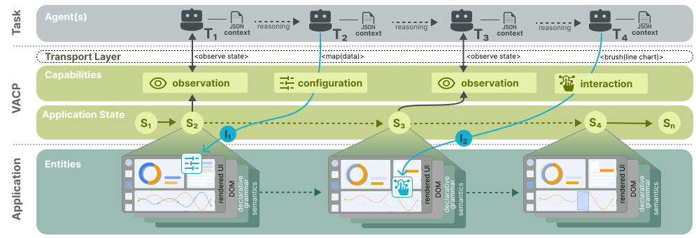

# VACP: Visual Analytics Context Protocol

[](https://arxiv.org/abs/2603.29322)


VACP (Visual Analytics Context Protocol) composes analytical sources into one graph with explicit ownership, coherent state observations, output freshness, and semantic operations for AI agents.

[Learn more about VACP at the documentation site](https://docs.vacp.dev), or [read the VACP research paper](https://arxiv.org/abs/2603.29322).

If you reference VACP, use the following citation:

```bibTeX
@misc{staehle2026vacp,
  title = {{VACP}: {Visual Analytics Context Protocol}},
  author = {{St{\"a}hle}, Tobias and {Gyarmati}, Péter Ferenc and {Spinner}, Thilo and {Sevastjanova}, Rita and {Moritz}, Dominik and {El-Assady}, Mennatallah},
  year = {2026},
  eprint = {2603.29322},
  archivePrefix = {arXiv},
  doi = {10.48550/arXiv.2603.29322}
}
```

## Fast Path

From repo root:

- Install dependencies: `make setup`
- Build workspace: `make build`
- Start examples gallery: `make dev` → `https://examples.vacp.localhost`
- Start docs and all examples: `make dev-all`
- Run checks: `make check` and `make browser-install e2e`

For full setup and command details, use [docs/get-started/index.md](docs/get-started/index.md).

## Workspace

Reusable protocol, runtime, providers, transports, and inspection primitives live in `packages/*`. Examples live in `examples/`, and the documentation host and browser suite in `apps/`. All use the root workspaces and lockfiles.

- Gallery: `examples/gallery`
- Browser tests: `apps/e2e`
- User documentation: `docs/`, hosted by `apps/docs`
- Internal guides: `development_docs/`
- Runtime contracts and dependency boundaries: [development_docs/architecture.md](development_docs/architecture.md)
- Setup, checks, and dependency updates: [development_docs/contributing.md](development_docs/contributing.md)

## Documentation

Visit [https://docs.vacp.dev/](https://docs.vacp.dev/) for the documentation and [https://examples.vacp.dev/](https://examples.vacp.dev/) for demos.

- Docs site entry: [docs/index.md](docs/index.md)
- Get started: [docs/get-started/index.md](docs/get-started/index.md)
- Overview: [docs/what-is-vacp/index.md](docs/what-is-vacp/index.md)
- Agent presence: [docs/presence/index.md](docs/presence/index.md)
- Core runtime: [docs/reference/runtime.md](docs/reference/runtime.md)
- Tool contract: [docs/reference/tool-contract.md](docs/reference/tool-contract.md)
- Runtime configuration: [docs/reference/configuration.md](docs/reference/configuration.md)
- Architecture spec: [development_docs/architecture.md](development_docs/architecture.md)
- Contributing guide: [development_docs/contributing.md](development_docs/contributing.md)

## Runtime Notes

- Build custom inspection surfaces with `@vacp/inspector-core` and an explicit session client.
- Start MCP server against a running example: `uv run vacp --url https://examples.vacp.localhost/vega-lite/`.

## Contact

For questions, [open an issue](https://github.com/ETH-IVIA-Lab/VACP/issues/new/choose) or contact [Tobias Stähle](https://ivia.ch/people/staehle).
