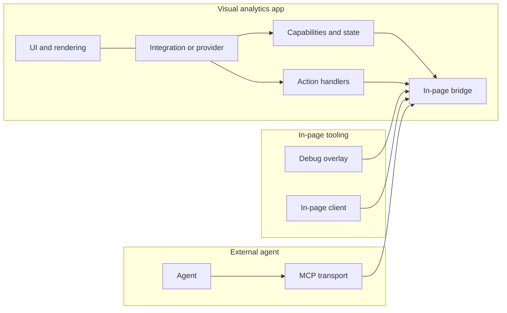

# Core runtime

VACP is a semantic layer that sits inside a visual analytics app. It exposes state and interactions in a form that stays stable across rerenders and independent of how the UI is drawn.

Tools can still use screenshots and DOM access for layout and feedback. The runtime exists so an agent can read precise state and execute validated actions without guessing from pixels.

<!-- diagram id="core-runtime-architecture" -->

## State representation

The runtime exposes a capabilities snapshot and a state snapshot.
Capabilities describe the interface as a graph of semantic entities and relations. State stores the current values under stable refs.

State can also be scoped by container refs. Reading state for a *View* or *Visualization* returns the descendant state entries that live under that container, such as *Widget*, *Selection*, and *DataHandle* entries.

Edges can describe containment and coordination, such as when a *Selection* in one *View* filters another *View*.

Stable refs matter because the interface is a living document. Rendering changes, but a *Selection* or *Param* should remain the same thing across the session.

## Interaction surface

VACP represents interactions as intent-level actions. An action describes what it does and which parameters it accepts.
The set of valid actions can change with state. That lets the app expose only what is safe and meaningful in the current context.

## Execution gateway

Action calls go through a single execution gateway. The gateway checks that the action exists, that it is still valid, and that parameters match the contract.
On success it returns a structured result. On failure it returns a structured error that can be corrected.

## Data access on demand

Visual analytics apps often sit on large datasets. The runtime does not try to serialize raw data into the state snapshot.
Instead, providers expose *DataHandle*s and actions to inspect and query them. In this repo the standard actions are `vacp.data_schema` and `vacp.data_sql`, commonly backed by [DuckDB](https://duckdb.org/).

## Package map

- `@vacp/core` in `packages/lib/protocol/core` defines protocol types and shared conventions.
- `@vacp/gateway` in `packages/lib/protocol/gateway` installs the in-page bridge and action execution gateway.
- `@vacp/kit` in `packages/lib/protocol/kit` is the default starting point for custom integrations.
- `@vacp/duckdb` in `packages/lib/protocol/duckdb` provides helpers for data actions.
