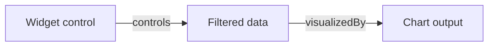

# Compose analytical providers

A composed VACP runtime can represent controls, data, and visual outputs owned by different systems.

```ts
const runtime = createVacpRuntime({
  providers: [widgetProvider, notebookProvider, chartProvider],
});

const observation = await runtime.observe();
```

Each provider owns its source description, nodes, state values, freshness records, and operations. Providers can reference another source's node through graph edges and operation metadata.

For a notebook containing a widget and a chart, a composed graph can express:



Object containment alone does not establish an analytical relationship. Discovery adapters should project types, bounds, synchronization, and dependency structure. Profiles add meanings such as filter, selection, aggregation, data handle, and visualization when the library or application knows them.

## Operation semantics

Operation descriptors use four kinds:

| Kind         | Behavior                                                  |
| ------------ | --------------------------------------------------------- |
| `mutation`   | Changes an existing live analysis or control.             |
| `creation`   | Creates a new analytical entity or view.                  |
| `evaluation` | Runs a parameterized analysis and produces a result.      |
| `query`      | Reads data or metadata without changing analytical state. |

`name` is the unique routing identity used for execution across the composed graph. `operation.contract` identifies a shared semantic contract such as `vacp.data_sql`. Several sources can implement the same contract with different action names. Custom contract IDs are ordinary strings. Discover a descriptor by contract and relevant entity, then execute its `name`.

`inputRefs` identify existing values consumed by the operation. `affects` identifies existing entities that may change. `results` describes produced state, entities, data, visualizations, or artifacts. `refParameters` marks parameters whose runtime values are refs.

## Freshness

Freshness belongs to outputs whose values may lag behind their inputs:

- `current`: the output reflects its declared input revision.
- `stale`: an input changed and the output has not recomputed.
- `running`: recomputation is active.
- `error`: recomputation failed and `message` describes the failure.

Providers set the completion boundary. VACP records the status and revisions supplied by the owner.

## Availability

[Declare prerequisites](./availability) to disclose nodes and actions only when their dependencies are ready. Discovery returns the available surface; `runtime.inspect()` retains the full catalog for inspection.
