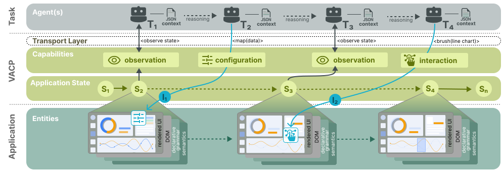

# What is VACP?

VACP (Visual Analytics Context Protocol) lets an AI agent work in a visual analysis the way the person using it does. The agent reads the views, selections, parameters, and data that are on screen, and changes them through named actions such as "brush the age axis from 22 to 28". The person watching sees each step on the charts as it happens. The [VACP paper](https://arxiv.org/abs/2603.29322) describes the design and its evaluation.



VACP runs inside the page. A [provider](../concepts/#provider) describes each analytical source, the [runtime](../concepts/#runtime) composes the providers into one [observation](../concepts/#observation), and the [page bridge](../concepts/#page-bridge) serves that observation to agents and to interfaces built for people.

<ArchitectureDiagram />

## Providers describe sources

A provider lists the views, selections, parameters, and data handles of one [source](../concepts/#provider), such as a chart, a dashboard, a set of form controls, or a notebook. It lists them as a graph, reports their current values as state, and applies actions through the source's own API. Each entity has a stable ref such as `vacp://analysis/overview/scatter/param/brush`, so an agent can refer to it across reads and rerenders.

`@ethivia/vacp-vega` creates providers for [Vega-Lite](https://vega.github.io/vega-lite/), a JSON grammar for charts. `@ethivia/vacp-vgplot` creates them for [Mosaic vgplot](https://idl.uw.edu/mosaic/vgplot/), a plotting library for linked views over a database. `createVacpProvider` from `@ethivia/vacp-sdk` creates one for anything else.

## The runtime composes one observation

The runtime reads every provider and publishes one observation: the graph, the state, which source owns each entity and action, and whether each output is up to date with its inputs. Open any [example](https://examples.vacp.dev/) and run this in the console:

```js
const observation = await window.__vacp.observe();
observation.graph.nodes.length; // entities across every source on the page
observation.graph.actions.map((action) => action.name); // actions available in the current state
```

A chart that has no data yet offers no brushing action until a dataset loads. [Core concepts](../concepts/) defines each part of an observation.

## Agents and people share one runtime

An agent executes an action by name, with parameters its schema accepts and a sentence for the person watching:

```js
await window.__vacp.execute(
  { name: 'cohort.set_sex', params: { sex: 'female' } },
  { narration: 'Keeping only female athletes.' },
);
```

The runtime validates the parameters and applies the change through the provider. It also observes the changes a person makes with the mouse. Both land in [provenance](../concepts/#provenance), where each record names its actor. Three features read those records:

- [Presence](../presence/) shows the agent's cursor travelling to each target with its sentence.
- [Replay](../provenance/) restores the charts to each of the agent's checkpoints.
- [Inspector](../inspector/) show the graph, its availability, and recorded observations for debugging and teaching.

External clients such as Claude Code connect through MCP, agents in the page through the AI SDK, and browser agents through WebMCP. [Page bridge](../concepts/#page-bridge) describes each path.

## Packages

Every app installs `@ethivia/vacp-sdk`, which holds the core in five entries:

| Entry                                             | Holds                                                                                                                                                          |
| ------------------------------------------------- | -------------------------------------------------------------------------------------------------------------------------------------------------------------- |
| `@ethivia/vacp-sdk`                               | [Actions and providers](../api/actions), the [runtime and page bridge](../api/runtime), [provenance](../api/provenance), and [protocol types](../api/protocol) |
| [`@ethivia/vacp-sdk/data`](../api/data)           | Data handles and SQL over any client of [DuckDB](https://duckdb.org), an in-process SQL database                                                               |
| [`@ethivia/vacp-sdk/presence`](../api/presence)   | Presence targets and the presence engine                                                                                                                       |
| [`@ethivia/vacp-sdk/agent`](../api/agent)         | Agent tools over a page bridge, and WebMCP registration                                                                                                        |
| [`@ethivia/vacp-sdk/inspector`](../api/inspector) | Inspection sessions and clients                                                                                                                                |

Add an integration for each library your app uses:

| Package                                   | Connects                                                                                       |
| ----------------------------------------- | ---------------------------------------------------------------------------------------------- |
| [`@ethivia/vacp-vega`](../api/vega)       | Vega-Lite views, as a provider                                                                 |
| [`@ethivia/vacp-vgplot`](../api/vgplot)   | Mosaic vgplot plots, inputs, and tables, as a provider                                         |
| [`@ethivia/vacp-duckdb`](../api/duckdb)   | [DuckDB-Wasm](https://duckdb.org/docs/api/wasm/overview), the DuckDB build that runs in a page |
| [`@ethivia/vacp-ai`](../api/ai)           | An in-page agent built on the AI SDK                                                           |
| [`@ethivia/vacp-overlay`](../api/overlay) | The presence cursor and sentence overlay in React, with Markdown bubbles in `/streamdown`      |
| [`@ethivia/vacp-posthog`](../api/posthog) | Runtime events to [PostHog](https://posthog.com), a product analytics tool                     |

The Python package [`vacp`](../api/python) runs the MCP server for external agents and hosts Python providers.

Next, [get started](../get-started/) with a slider an agent can move, or [install the packages](../install/) in your application.
