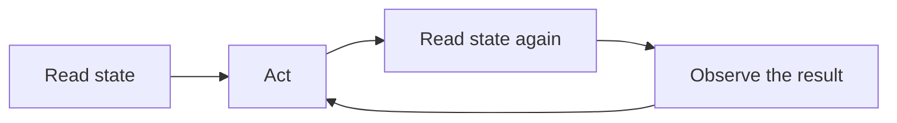

# Why VACP?

Visual analytics interfaces are built for human perception and input devices. They encode data into pixels and accept mouse gestures.

Agents that rely on screenshots or generic DOM traversal have to reconstruct the interface from weak signals. Dense charts hide exact values. Canvas plots look like a single node. SVG plots often look like thousands of anonymous paths.

VACP reduces this mismatch by exposing a semantic layer at runtime. Instead of guessing, an agent can read state, discover valid interactions, and execute intent-level actions.

## What changes with a semantic layer

With VACP, the app tells you what exists, what is selected, and what can be done next. Actions are validated. Results and errors are structured.

This keeps a workflow closed-loop. Read state, act, read state again, and use the visual output as feedback.

<!-- diagram id="why-vacp-closed-loop" -->

## What you still decide

An integration still has to make choices:

- What the stable entities are
- Which values belong in state
- Which actions match user intent
- Which descriptions help disambiguate

Those choices are the quality bar. VACP is the contract that makes them accessible.
