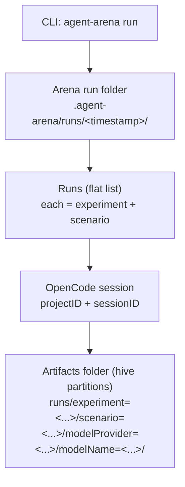

# @vacp/agent-arena

Config-driven CLI for running OpenCode sessions via `@opencode-ai/sdk`.

## Install

From repo root:

- `pnpm -C packages/agent-arena install`
- `pnpm -C packages/agent-arena build`

## Usage

Create one file in the directory you run from:

- `agent-arena.config.ts` (a flat `runs` array; you can generate it however you want)

Then run:

- Ensure OpenCode is running (defaults to `http://127.0.0.1:4096`): `opencode serve --hostname=127.0.0.1 --port=4096`
- Ensure `agent-browser` is installed and on your PATH: `agent-browser`
- `pnpm -C packages/agent-arena start -- run`
- (override OpenCode project directory) `pnpm -C packages/agent-arena start -- run --directory ..`
- (export OpenCode logs + metrics) `pnpm -C packages/agent-arena start -- run --export-logs`

Outputs are written to `./.agent-arena/runs/<timestamp>/` by default, including per-run JSON with `projectID` + `sessionID` (portable across machines).

## Scenario × Setup Matrix (paper supplement)

The matrix scenarios/experiments are defined in `packages/agent-arena/agent-arena.config.ts`.

To run them end-to-end:

- Start the examples hub (in another terminal): `pnpm dev:examples`
- Ensure Playwright browsers are installed (needed by `agent-browser`): `pnpm exec playwright install chromium`
- Run: `pnpm -C packages/agent-arena start -- run --export-logs --write-metrics --out nogit/scenario-report-matrix/<YYYY-MM-DD>`

This writes the standard `agent-arena` output structure into the `--out` directory (per-run folders + `results.json`, plus exported OpenCode logs/metrics when enabled).

## Concepts

- **Arena run**: One CLI invocation (`agent-arena run`). Produces one timestamped run folder under `./.agent-arena/runs/<timestamp>/`.
- **Experiment**: One configuration of the agent (LLM + tools exposure). Tools include built-in OpenCode tools (e.g. `webfetch`, `bash`, `edit`) and MCP tools (e.g. `context7_*`).
- **Scenario**: One task instance (a URL to your VA app + a task description).



### Telemetry

Each run writes:

- `run.json` (high-level result, IDs only)
- `input.json` (per-run inputs: rendered prompt + title + tool settings; includes `run.slug`)
- For detailed telemetry (tokens/cost/tool calls), read OpenCode’s native session/message logs on disk for the given `projectID` + `sessionID`.

### Parallel runs

Control parallelism by setting:

- `concurrency.runs` in `agent-arena.config.ts`

## Arena config (TS)

`agent-arena.config.ts` defines a flat list of runs. A run binds:

- an **experiment** (model + tools) and
- a **scenario** (URL + task).

You can generate the `runs` array programmatically (nested loops, filtering, custom combinations).

```ts
import type { ArenaConfig } from '@vacp/agent-arena';

// Define scenarios once...
const scenarios = [
  {
    id: 'weather-jacket',
    url: 'http://127.0.0.1:5173/mosaic/#weather',
    task: 'In summer, how many days would I probably need a jacket (rain/drizzle/snow), and what percent of summer days is that?',
  },
];

// ...and define experiment variants...
const experiments = [
  {
    experiment: 'openai/gpt-5.2 (default tools)',
    model: { providerID: 'openai', modelID: 'gpt-5.2' },
    toolPolicy: { mode: 'all' },
    summarize: true,
  },
];

const config: ArenaConfig = {
  worktreeRoot: true,
  autoApprove: 'always',
  concurrency: { runs: 2 },
  timeouts: { promptMs: 10 * 60_000 },

  // Rendered right before prompting, so it can include run folder etc.
  // Available in `run`: `outDir`, `slug`. Available in `opencode`: `projectID`, `sessionID`.
  promptTemplate: ({ scenario, run }) =>
    [`URL: ${scenario.url}`, `Artifacts directory: ${run.outDir}`, ``, `Task: ${scenario.task}`].join('\\n'),

  // Finally, flatten to runs (this is what the runner consumes).
  runs: experiments.flatMap((exp) =>
    scenarios.map((scenario) => ({
      ...exp,
      scenario,
    })),
  ),
};

export default config;
```

### MCP / OpenCode server config (optional)

`agent-arena` runs all runs against a single `opencode serve` process. OpenCode’s MCP server definitions are global to that process, so `agent-arena` applies MCP _server setup_ additively (union across runs), and uses tool permissions to control MCP _exposure_ per run.

Configure per-run MCP like this:

```ts
{
  runs: [
    {
      experiment: "…",
      model: { providerID: "openai", modelID: "gpt-5.2" },
      scenario: { id: "s1", url: "http://…", task: "…" },

      // Add/connect MCP servers needed by this experiment (merged across experiments).
      mcp: {
        servers: {
          context7: { type: "remote", url: "https://mcp.context7.com/mcp" },
        },
        // Allow tools from these MCP servers for this run.
        // `context7` expands to the wildcard permission `context7_*`.
        // You can also pass raw patterns like `context7_search_*`.
        allow: ["context7"],
      },

      // Optional: restrict all tools (including MCP) via a wildcard deny, then allow a small set.
      toolPolicy: { mode: "allow", ids: ["webfetch", "context7_*"] },
    },
  ],
}
```

Note: OpenCode’s `write`/`edit`/`patch`/`multiedit` tools all use the same permission gate (`edit`). `agent-arena` normalizes `functions.write`/`write`/`patch` to `edit` so allow/deny behaves as expected.

### Session visibility in the web UI

OpenCode’s UI filters sessions by the currently selected directory. `agent-arena` uses the OpenCode-reported worktree root by default (`worktreeRoot: true`) so sessions appear where you expect in the UI.

To force a specific directory (project context), use:

- CLI: `--directory <path>`
- Config: `directory: "/abs/path"`

## Examples

See `packages/agent-arena/agent-arena.config.ts`.
