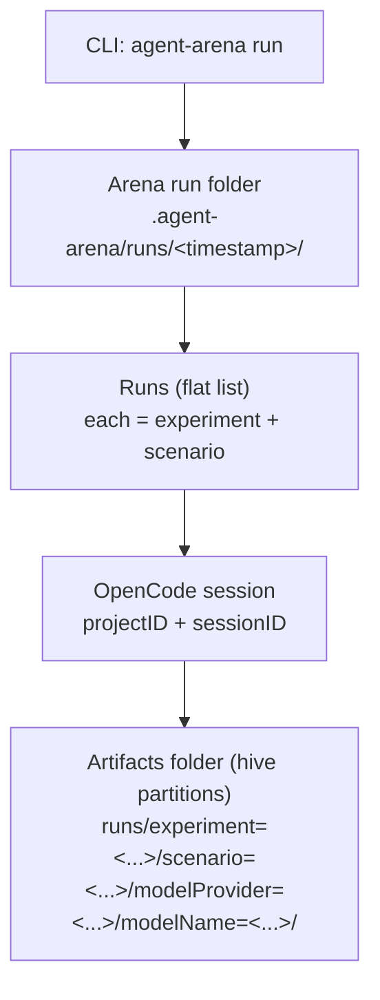

# @vacp/agent-arena

Config-driven CLI for running OpenCode sessions via `@opencode-ai/sdk`.

## Install

From repo root:

- `pnpm -C packages/agent-arena install`
- `pnpm -C packages/agent-arena build`

## Usage

Create one file in the directory you run from:

- `agent-arena.config.ts` (a flat `runs` array; you can generate it however you want)

Then run:

- Ensure OpenCode is running (defaults to `http://127.0.0.1:4096`): `opencode serve --hostname=127.0.0.1 --port=4096`
- Ensure `agent-browser` is installed and on your PATH: `agent-browser`
- `pnpm -C packages/agent-arena start -- run`
- (override OpenCode project directory) `pnpm -C packages/agent-arena start -- run --directory ..`
- (export OpenCode logs + metrics) `pnpm -C packages/agent-arena start -- run --export-logs`

Outputs are written to `./.agent-arena/runs/<timestamp>/` by default, including per-run JSON with `projectID` + `sessionID` (portable across machines).

### Resuming an interrupted run

If you interrupted a long run, resume it in-place:

- `pnpm -C packages/agent-arena start -- resume --run .agent-arena/runs/<runId>`
- (plan only) `pnpm -C packages/agent-arena start -- resume --run .agent-arena/runs/<runId> --dry-run`
- (also rerun `ok=false` jobs) `pnpm -C packages/agent-arena start -- resume --run .agent-arena/runs/<runId> --rerun-failed`

`resume` reuses any existing finished `run.json` results (ok or failed) and runs only missing/unfinished jobs. It also detects partial artifacts from mid-run interruption and reruns those jobs.

After you have a run folder, you can parse it into tabular datasets and generate a publication-ready report:

```bash
# From packages/agent-arena/
pnpm start -- analyze --run .agent-arena/runs/<runId>
pnpm start -- datasets --analysis .agent-arena/runs/<runId>/analysis
pnpm start -- report --analysis .agent-arena/runs/<runId>/analysis
```

You can also pass `--opencode-root <dir>` to `analyze`, `report`, or `datasets` when OpenCode storage is not in a default location.

`analyze` also writes `transcript.md` into every per-job run folder under `runs/**`, reconstructing session conversation text (including tool context) from the run-local evidence snapshot. Jobs without a session ID or without messages still get a placeholder transcript with an explicit status note.

The report writes a small multi-page suite (one page per model, plus an index):

- `analysis/report/index.html` (model index + links)
- `analysis/report/all/index.html` (combined report across all models)
- `analysis/report/models/<model>/index.html` (per-model report)
- `analysis/report/**/figures/*.svg` (publication-ready charts)
- `analysis/report/**/data/*.json` (per-chart datasets; JSON arrays)
- In the HTML report, each chart also includes `SVG` / `PNG` / `Data` download actions.

Self-contained evidence notes:

- `analyze` now enforces a run-local Opencode evidence snapshot under:
  - `<runDir>/evidence/opencode-storage/`
  - manifest: `<runDir>/evidence/opencode-storage/manifest.json`
- Required session-scoped artifacts are copied (strict mode): `message/`, `part/`, matching `session/**/<sessionID>.json`, and `project/<projectID>.json`.
- `report` and `datasets` also enforce this snapshot preflight. If required evidence is missing and cannot be copied, the command fails.

Evaluation notes:

- `agent-arena analyze` classifies each run into `eval_outcome` buckets (e.g. `plumbing_failure`, `protocol_failure`, `semantic_failure`, `solved_strict`).
- `solved_strict` / `solved_semantic` are set to `null` when a run is not gradeable (so solved rates use the right denominator).
- The report index/summary include coverage columns (`Plumbing OK`, `Parsed OK`, `Gradeable`) to separate infra/protocol issues from semantic accuracy.
- Token accounting is shown in three explicit bases:
  - `no-cache = input + output + reasoning`
  - `with-cache(read) = no-cache + cache_read`
  - `with-cache(read+write) = no-cache + cache_read + cache_write`
- Cost accounting is shown in USD per run:
  - primary `cost_usd`: provider-reported session cost when available and non-zero,
  - fallback: estimated from `model.pricing` in `MODELS` (or run model config),
  - strict mode: if fallback is required but no pricing exists for that model, `agent-arena analyze` fails with a clear error.
- Report summaries/charts now treat **with-cache(read+write)** as the primary token metric.
- The report includes a dedicated **Token Accounting** section and separate median charts for:
  - **Median Token Accounting by Experiment (No Cache)**
  - **Median Token Accounting by Experiment (With Cache)**
- Scenario solved heatmaps are categorical (green/yellow/red) to distinguish solves with observed `vacp_execute` vs no `vacp_execute` signal vs failures.

The datasets export writes:

- `analysis/datasets/*.json` (derived tables + indices)
- `analysis/datasets/charts/*.json` (per-chart datasets; JSON arrays)
- includes token-accounting tables:
  - `analysis/datasets/token_accounting_by_experiment.json`
  - `analysis/datasets/token_accounting_by_task.json`
- run and summary datasets include cost fields:
  - run-level: `cost_provider_usd`, `cost_estimated_usd`, `cost_usd`, `cost_basis`
  - summary/task-level: `cost_median_usd`

Implementation notes (for maintainers):

- `src/eval/outcome.ts` is the single source of truth for run outcome classification (`plumbing_failure` vs `protocol_failure` vs semantic correctness).
- `src/report/prepare.ts` is shared by the report generator and datasets exporter so filtering + ordering + summary stats stay consistent.

Optional customization (useful for paper-ready exports):

```bash
# Smaller, larger-font figures (global theme overrides)
pnpm start -- report --analysis .agent-arena/runs/<runId>/analysis --width 640 --font-size 14

# Render only a subset of charts / sections
pnpm start -- report --analysis .agent-arena/runs/<runId>/analysis --charts solved-strict,pareto --sections figures,footer

# Per-chart overrides (JSON object keyed by chart id)
pnpm start -- report --analysis .agent-arena/runs/<runId>/analysis --chart-config ./report.charts.json
```

## Scenario × Setup Matrix (paper supplement)

The matrix scenarios/experiments are defined in `packages/agent-arena/agent-arena.config.ts`.

To run them end-to-end:

- Start the examples hub (in another terminal): `pnpm dev:examples`
- Ensure Playwright browsers are installed (needed by `agent-browser`): `pnpm exec playwright install chromium`
- Run: `pnpm -C packages/agent-arena start -- run --export-logs --write-metrics --out nogit/scenario-report-matrix/<YYYY-MM-DD>`

This writes the standard `agent-arena` output structure into the `--out` directory (per-run folders + `results.json`, plus exported OpenCode logs/metrics when enabled).

## Concepts

- **Arena run**: One CLI invocation (`agent-arena run`). Produces one timestamped run folder under `./.agent-arena/runs/<timestamp>/`.
- **Experiment**: One configuration of the agent (LLM + tools exposure). Tools include built-in OpenCode tools (e.g. `webfetch`, `bash`, `edit`) and MCP tools (e.g. `context7_*`).
- **Scenario**: One task instance (a URL to your VA app + a task description).



### Telemetry

Each run writes:

- `run.json` (high-level result, IDs only)
- `input.json` (per-run inputs: rendered prompt + title + tool settings; includes `run.slug`)
- For detailed telemetry (tokens/cost/tool calls), use the run-local snapshot in `<runDir>/evidence/opencode-storage` for the given `projectID` + `sessionID`.

### Parallel runs

Control parallelism by setting:

- `concurrency.runs` in `agent-arena.config.ts`

## Arena config (TS)

`agent-arena.config.ts` defines a flat list of runs. A run binds:

- an **experiment** (model + tools) and
- a **scenario** (URL + task).

You can generate the `runs` array programmatically (nested loops, filtering, custom combinations).

```ts
import type { ArenaConfig } from '@vacp/agent-arena';

// Define scenarios once...
const scenarios = [
  {
    id: 'weather-jacket',
    url: 'http://127.0.0.1:5173/mosaic/#weather',
    task: 'In summer, how many days would I probably need a jacket (rain/drizzle/snow), and what percent of summer days is that?',
  },
];

// ...and define experiment variants...
const experiments = [
  {
    experiment: 'openai/gpt-5.2 (default tools)',
    model: {
      providerID: 'openai',
      modelID: 'gpt-5.2',
      // USD per 1M tokens; used by analysis fallback when provider cost is missing/zero.
      pricing: { input: 1.75, output: 14.0, cacheRead: 0.175, cacheWrite: 0.0 },
    },
    toolPolicy: { mode: 'all' },
    summarize: true,
  },
];

const config: ArenaConfig = {
  worktreeRoot: true,
  autoApprove: 'always',
  concurrency: { runs: 2 },
  timeouts: { promptMs: 10 * 60_000 },

  // Rendered right before prompting, so it can include run folder etc.
  // Available in `run`: `outDir`, `slug`. Available in `opencode`: `projectID`, `sessionID`.
  promptTemplate: ({ scenario, run }) =>
    [`URL: ${scenario.url}`, `Artifacts directory: ${run.outDir}`, ``, `Task: ${scenario.task}`].join('\\n'),

  // Finally, flatten to runs (this is what the runner consumes).
  runs: experiments.flatMap((exp) =>
    scenarios.map((scenario) => ({
      ...exp,
      scenario,
    })),
  ),
};

export default config;
```

### MCP / OpenCode server config (optional)

`agent-arena` runs all runs against a single `opencode serve` process. MCP servers are added per run. When concurrent runs would share the same MCP server name, `agent-arena` rewrites names to lane-scoped aliases at runtime (for example `arena_vacp__lane1`, `arena_vacp__lane2`) so runs can execute in parallel without name collisions.

In config, keep using your canonical server names. Lane aliases are runtime-only.

Configure per-run MCP like this:

```ts
{
  runs: [
    {
      experiment: "…",
      model: { providerID: "openai", modelID: "gpt-5.2" },
      scenario: { id: "s1", url: "http://…", task: "…" },

      // Add/connect MCP servers needed by this run.
      // Names may be lane-aliased at runtime for concurrency, but config stays canonical.
      mcp: {
        servers: {
          context7: { type: "remote", url: "https://mcp.context7.com/mcp" },
        },
        // Allow tools from these MCP servers for this run.
        // `context7` expands to the wildcard permission `context7_*`.
        // You can also pass raw patterns like `context7_search_*`.
        allow: ["context7"],
      },

      // Optional: restrict all tools (including MCP) via a wildcard deny, then allow a small set.
      toolPolicy: { mode: "allow", ids: ["webfetch", "context7_*"] },
    },
  ],
}
```

Note: OpenCode's `write`/`edit`/`patch`/`multiedit` tools all use the same permission gate (`edit`). `agent-arena` normalizes `functions.write`/`write`/`patch` to `edit` so allow/deny behaves as expected.

### Session visibility in the web UI

OpenCode's UI filters sessions by the currently selected directory. `agent-arena` uses the OpenCode-reported worktree root by default (`worktreeRoot: true`) so sessions appear where you expect in the UI.

To force a specific directory (project context), use:

- CLI: `--directory <path>`
- Config: `directory: "/abs/path"`

## Examples

See `packages/agent-arena/agent-arena.config.ts`.

## Analysis of Agent Behavior

### Analyze downloaded runs

If you want to inspect existing runs without generating new ones:

1. Download the archive from Google Drive (ETH Google account required):  
   https://drive.google.com/file/d/1HlIi5d0NS8LaAJXGB8W9es4M4U2_zNfA/view?usp=sharing
2. Place and unpack it into:
   `packages/agent-arena/.agent-arena`
3. Install `uv`:
   https://docs.astral.sh/uv/getting-started/installation/
4. From repo root, open the analysis workbench:

```bash
uvx --with 'marimo[sandbox]' marimo edit packages/agent-arena/workbench/analysis.py --sandbox
```
